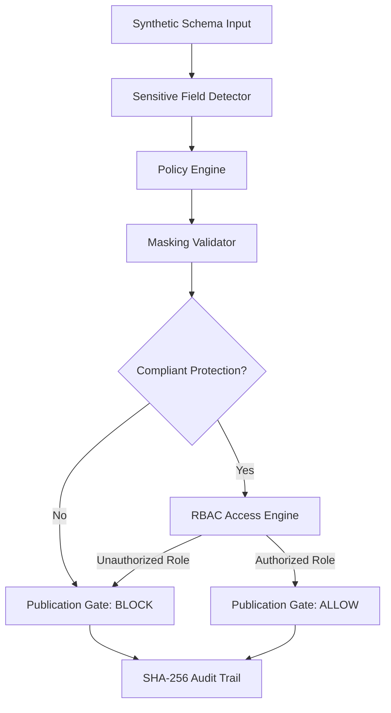

# University DataShield 🛡️
**Automated Sensitive-Field Discovery & Masking Validator**

> **University DataShield prevents sensitive university data from reaching analytics systems without the required protection by combining explainable sensitive-field discovery, masking-policy validation, RBAC, publication gating, auditability, governed policy changes, and rollback.**

---

## 1. Problem

Universities regularly publish datasets for educational research, accreditation, and institutional analytics. These datasets often inadvertently contain sensitive student information (names, student IDs, GPAs, contact details, disciplinary markers). Manual review is slow, error-prone, and does not scale. A single leaked direct identifier can violate FERPA regulations and expose the university to legal liability.

## 2. Solution

University DataShield provides an authoritative, fail-closed governance pipeline:
1. **Automated Discovery**: Identifies PII and FERPA-sensitive fields using four explainable signals (name regex, value pattern, data type, semantics).
2. **Policy Enforcement**: Resolves institutional masking requirements (`MASK`, `HASH`, `GENERALIZE`, `SUPPRESS`).
3. **Role-Based Access Control**: Validates whether the publishing persona holds required privileges.
4. **Authoritative Publication Gate**: Evaluates exports on the backend. When protection fails, the default outcome is **BLOCK**.
5. **Cryptographic Audit Trail**: Records every decision in an append-only, SHA-256 chained ledger.
6. **Governed Changes & Safe Rollback**: Prevents self-approval, creates immutable versions, and auto-revalidates rollbacks.

---

## 3. How It Works

```text
Synthetic University Schema
            ↓
Sensitive Field Discovery Engine (Name, Pattern, DataType, Semantic signals)
            ↓
Classification (Direct Identifier, Quasi-Identifier, Academic Data, Non-Sensitive)
            ↓
Policy Engine (Institutional Overrides > Classification Defaults)
            ↓
Masking Validator (Ensures actual transformation matches required protection)
            ↓
Role Check (Verifies user holds publication privileges)
            ↓
Publication Gate (Strict Fail-Closed Default Deny)
            ↓
    [ ALLOW / BLOCK ]
            ↓
Append-Only SHA-256 Chained Audit Ledger
```

---

## 4. Architecture

Detailed technical diagrams and component breakdowns are in [docs/architecture.md](docs/architecture.md).



---

## 5. Key Features

- **Multi-Signal Discovery**: Combines field-name rules, pattern regexes, data types, and semantic context.
- **Explainable Decisions**: Every flagged field includes confidence scores, signal breakdowns, and human-readable reasons.
- **Precedence-Aware Policy Resolution**: Field-specific institutional rules take precedence over classification defaults.
- **Separation of Duties**: Proposers cannot approve their own policy changes (`409 SELF_APPROVAL_BLOCKED`).
- **Cryptographic Tamper-Evidence**: Detects unauthorized alterations to SQLite audit records via SHA-256 chaining.
- **Automated Post-Rollback Revalidation**: Immediately validates synthetic benchmarks upon policy rollback.
- **Executive Dashboard**: Displays real-time metrics, live system indicators, and one-click demo reset.

---

## 6. Security Controls

| Threat / Risk | Defense Mechanism | Verified Behavior |
| :--- | :--- | :--- |
| **Unmasked Direct Identifier** | Publication Gate Policy Match | **BLOCKED** (`PUBLICATION_BLOCKED`) |
| **Unauthorized Publishing** | RBAC Privilege Check | **BLOCKED** (`UNAUTHORIZED`) |
| **Client-Side Approval Spoofing** | Authoritative Backend Revalidation | **BLOCKED** (Client flags ignored) |
| **Wrong Transformation** | Strict Action Verification | **BLOCKED** (e.g. `GENERALIZE` vs `MASK`) |
| **Missing Policy on Sensitive Field** | Fail-Closed Default Deny | **BLOCKED** (Unmapped fields rejected) |
| **Self-Approved Policy Changes** | Separation of Duties Gate | **BLOCKED** (`409 SELF_APPROVAL_BLOCKED`) |
| **Audit Log Tampering** | SHA-256 Cryptographic Hash Chain | **DETECTED** (`status="COMPROMISED"`) |
| **Unsafe Policy Degradation** | Security Admin Rollback + Revalidation | **RESTORED** (Auto-revalidated to safe state) |

---

## 7. Experimental Results

Measured against the synthetic benchmark dataset (52 fields) compared to the Phase 3 keyword baseline:

| Metric | Phase 3 Keyword Baseline | University DataShield | Improvement |
| :--- | :---: | :---: | :---: |
| **Precision** | 70.0% | **100.0%** | **+30.0%** |
| **Recall** | 58.3% | **75.0%** | **+16.7%** |
| **F1 Score** | 63.6% | **85.7%** | **+22.1%** |
| **Accuracy** | 53.8% | **84.6%** | **+30.8%** |
| **False Positives** | 3 | **0** | **-3 (Zero false blocks)** |
| **False Negatives** | 5 | **3** | **-2** |
| **Unsafe Publication Prevention** | *N/A (Detection only)* | **100.0%** | **Authoritative Gate Enforcement** |

See [docs/final-results.md](docs/final-results.md) for detailed breakdowns.

---

## 8. Failure Testing Scorecard

Results from the 14-scenario adversarial validation suite (`backend/security_validation/`):

```text
Unsafe Publication Prevention:   100.0%  (9/9 unsafe attempts blocked)
Unauthorized Block Rate:         100.0%  (2/2 unauthorized roles blocked)
Audit Coverage Rate:             100.0%  (14/14 security events recorded)
Rollback Recovery Rate:          100.0%  (Safe policy restored and revalidated)
False Block Rate:                  0.0%  (Zero legitimate schemas blocked)
Audit Integrity Detection:       100.0%  (Cryptographic tampering caught)
```

---

## 9. Privacy by Design

- **100% Synthetic Data**: Evaluated strictly on synthetic test datasets. No real student or university records exist in this repository.
- **Zero Raw PII Storage**: Automated regression test `test_11_zero_raw_pii_in_all_governance_records` verifies via full-text column scans that no raw sensitive tokens are persisted in `audit_events`, `policy_change_requests`, `policy_versions`, or `publication_attempts`.

---

## 10. Demo Instructions & Quick Verification

### One-Command System Verification
```bash
python scripts/verify_final.py
```

### Full 23-Step Evaluator Demo Script
```bash
python backend/demo_final_verification.py
```

### Interactive Web UI
1. **Start Backend**:
   ```bash
   cd backend && .venv\Scripts\activate && uvicorn main:app --port 8000
   ```
2. **Start Frontend**:
   ```bash
   cd frontend && npm run dev
   ```
3. Open `http://localhost:5173` to explore the Executive Dashboard, Adversarial Validation Panel, and Evaluator Journey.

---

## 11. Core REST APIs

| Endpoint | Method | Purpose |
| :--- | :---: | :--- |
| `/health` | GET | Service liveness, DB connection, Phase 8 status |
| `/dashboard/summary` | GET | Aggregated real-time executive metrics and health indicators |
| `/demo/reset` | POST | Deterministic environment reset to baseline v1.0 |
| `/scan` | POST | Scan schema columns for sensitive fields |
| `/policies/validate` | POST | Validate field masking compliance against active rules |
| `/publish-check` | POST | Pre-publication safety evaluation and role authorization |
| `/publish` | POST | Authoritative backend publication gate execution |
| `/roles` | GET | Full role-permission capability matrix |
| `/audit` | GET | Query immutable audit ledger |
| `/audit/integrity` | GET | Verify SHA-256 cryptographic chain integrity |
| `/policies/propose` | POST | Propose policy change (holds in PENDING status) |
| `/policies/approve` | POST | Security Admin approval (enforces no self-approval) |
| `/policies/rollback` | POST | Safe rollback with automatic post-revalidation |
| `/security-validation/results` | GET | Run 14-scenario adversarial failure suite |
| `/pipeline/validate` | POST | Phase 10: Ingest & validate analytical pipeline dataset |
| `/pipeline/preview` | POST | Phase 10: Preview synthetic masking transformations |
| `/pipeline/publish` | POST | Phase 10: Fail-closed publication gate execution |
| `/pipeline/batch` | POST | Phase 10: Fail-closed multi-dataset batch validation |
| `/pipeline/runs` | GET | Phase 10: Query pipeline validation ledger |
| `/pipeline/{id}/report` | GET | Phase 10: Machine- & human-readable markdown verification report |
| `/ready` | GET | Phase 11: Production orchestration readiness probe |
| `/auth/token` | POST | Phase 11: Issue signed OAuth2/OIDC JWT access token |
| `/auth/me` | GET | Phase 11: Authenticated identity and resolved role |
| `/pipeline/jobs/submit` | POST | Phase 11: Asynchronous worker queue submission |
| `/pipeline/jobs/{id}` | GET | Phase 11: Check background job status and state machine |
| `/pipeline/jobs/{id}/retry`| POST | Phase 11: Safe retry recovery (fail-closed security preserved) |
| `/pipeline/worker/stats` | GET | Phase 11: Background worker queue telemetry |
| `/pipeline/destination/publish` | POST | Phase 11: Publish validated dataset to warehouse (ALLOW only) |

---

## 12. Honest Limitations

- **Simulated Identity Support**: While Phase 11 introduces a complete OAuth2/OIDC JWT validation architecture with token issuance, issuer/audience/signature checking, and role resolution, local demonstration mode retains the demo persona switcher (`AUTH_ENABLED=false`). In production mode (`AUTH_ENABLED=true`), Bearer tokens are mandatory.
- **Worker Queue Infrastructure**: Phase 11 provides a tested in-process asynchronous worker queue with safe retries. Multi-node clusters should connect a distributed broker (e.g. Celery/Redis).
- **Destination Connectors**: The `MockWarehouseDestination` is queryable and verified; cloud connectors (`SnowflakeDestination`, `BigQueryDestination`, `DatabricksDestination`) are architectural interfaces requiring external cloud credentials.
- **Single-Node SQLite vs PostgreSQL**: Phase 11 introduces the `DatabaseAdapter` interface supporting both SQLite and PostgreSQL.

See [docs/limitations.md](docs/limitations.md) and [docs/phase11-production-hardening.md](docs/phase11-production-hardening.md) for complete disclosures.

---

## 13. Test Results & Build Status

```text
Automated Pytest Suite:    270 / 270 passed (pytest tests/ -q in 7.28s)
Phase 11 New Tests:        29 / 29 passed (tests/test_phase11_production_security.py)
Phase 10 Tests:            22 / 22 passed (tests/test_phase10_pipeline.py)
Frontend Production Build: Clean (tsc -b && vite build in 1.31s, 0 errors)
Final Verification:        11 / 11 Pillars PASS (scripts/verify_final.py)
Final Evaluator Demo:      23 / 23 Steps PASS (backend/demo_final_verification.py)
Phase 11 Status:           COMPLETE (Production Security & Scalability Verified)
```

---

## License

MIT — for research and educational purposes.
