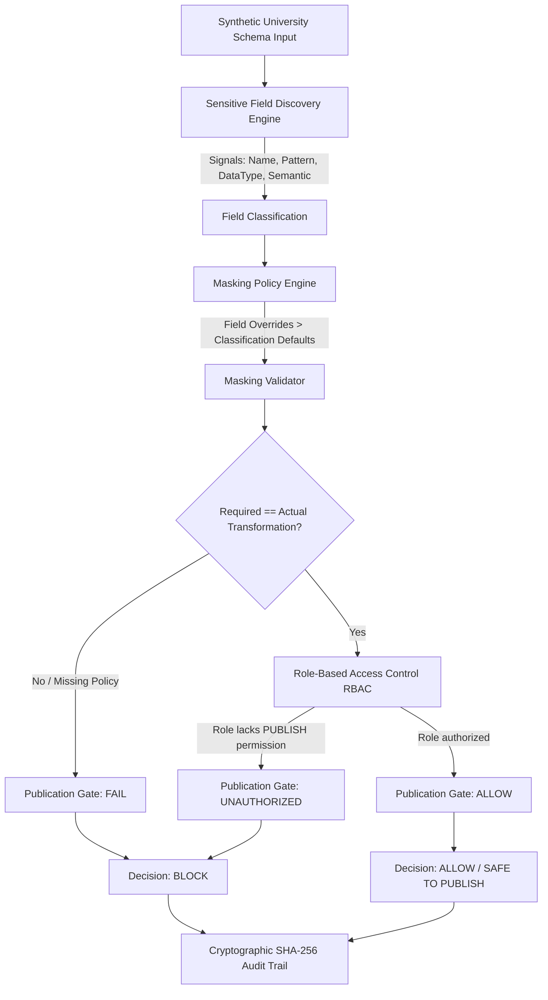
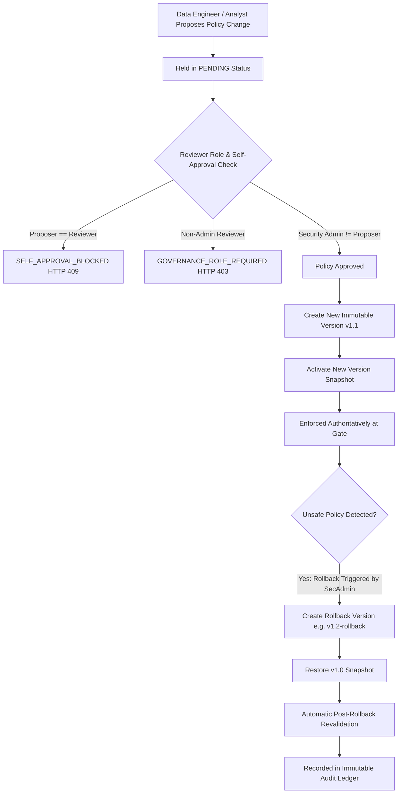

# University DataShield — System Architecture

## 1. System Overview

University DataShield is an automated sensitive-field discovery, masking-policy validation, role-based access control, publication gate, and governance platform designed to protect sensitive student and institutional records before analytics release.

The fundamental security principle across all components is:
> **"When sensitive-data protection fails, the default outcome is BLOCK rather than unsafe publication."**

---

## 2. End-to-End Publication Gate Pipeline



---

## 3. Governance, Versioning & Safe Rollback Lifecycle



---

## 4. Component Subsystems

| Layer / Subsystem | Primary Python / TS Modules | Key Guarantees |
| :--- | :--- | :--- |
| **Detection Engine** | `backend/detection/` | 4 explainable detection signals (`field_name`, `value_pattern`, `data_type`, `semantic`), 0% false positive rate on benchmark |
| **Masking Policy Engine** | `backend/policies/` | Deterministic precedence (`field_overrides` > `classification_defaults`), transforms (`MASK`, `HASH`, `GENERALIZE`, `SUPPRESS`) |
| **Role-Based Access (RBAC)** | `backend/access/` | Default deny, 5 university roles (`SECURITY_ADMIN`, `DATA_ENGINEER`, `ANALYST`, `FACULTY`, `PLACEMENT_ADMIN`) |
| **Publication Gate** | `backend/publication/` | Authoritative backend enforcement, client-side flags rejected, fail-closed default on unconfigured fields |
| **Audit Ledger** | `backend/audit/` | Cryptographic SHA-256 hash chaining (`event_hash = SHA256(prev_hash + metadata)`), tamper detection |
| **Policy Governance** | `backend/governance/` | Separation of duties (no self-approval), immutable policy snapshots, automated revalidation |
| **Security Validation** | `backend/security_validation/` | 14 adversarial failure scenarios verifying default deny, bypass resistance, and cryptographic tamper alerts |
| **Demo & Executive Service** | `backend/demo/` | Live executive metrics aggregation, deterministic demo environment baseline reset |
| **Frontend UI** | `frontend/src/` | React 19 + TypeScript + Vite + Tailwind, live system status, adversarial attack simulation panel |

---

## 5. Persistence Architecture

```text
SQLite Database (data/datashield.db)
├── system_events          (Infrastructure markers)
├── scan_results           (Scan runs & sensitive column counts)
├── field_results          (Per-column detection signals & reasons)
├── evaluation_runs        (Accuracy & F1 benchmarking logs)
├── policies               (Active institutional policy definitions)
├── policy_validations     (Validation execution audits)
├── publication_attempts   (Gate release verdicts and reasons)
├── audit_events           (SHA-256 chained immutable audit trail)
├── policy_versions        (Immutable snapshots of policy state)
└── policy_change_requests (Proposed, reviewed, and approved changes)
```

---

## 6. Privacy & Data Minimization Architecture

1. **Synthetic-Only Data**: No real student records are ever accepted or stored.
2. **Schema Metadata Storage**: Tables store column metadata, classifications, and transformation codes rather than raw cell values.
3. **Automated PII Scans**: Automated tests inspect all SQLite columns to verify zero leakage of sensitive test tokens.
